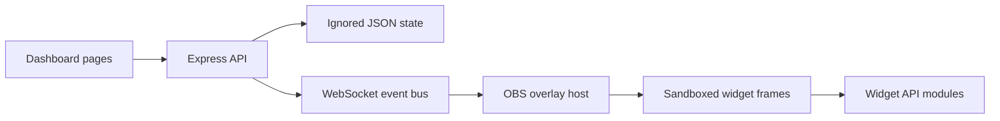

# StreamForge

StreamForge is a local dashboard and OBS browser overlay for community-built stream widgets. This repository is being built in ordered phases; the current baseline provides the dashboard shell, mock event path, starter widgets and an isolated overlay preview.

## Run locally

1. Install Node.js 20 or newer.
2. Copy `.env.example` to `.env` and set only the credentials you intend to use. Keep `.env` private.
3. Run `npm install` and `npm start`.
4. Open `http://localhost:3000/dashboard/`. Set `OPEN_BROWSER=false` to suppress auto-open. Set `PORT` to use a different port.

The initial default is mock mode. The dashboard's Simulate buttons generate local events; they do not contact Twitch. The OBS browser source URL is `http://localhost:3000/overlay/` (the transparent canvas is intended for OBS).

## Twitch callback

Register `http://localhost:3000/auth/twitch/callback` as the OAuth redirect URL in the Twitch Developer Console. If you change `PORT`, use `http://localhost:<PORT>/auth/twitch/callback` instead. Live Twitch behavior is gated by `TWITCH_LIVE_ENABLED=true`.

## Project structure

## Widget API and security

Widget modules export `default { meta, mount(api) }`; the current contract is documented in [docs/WIDGET_API.md](docs/WIDGET_API.md). The overlay uses `sandbox="allow-scripts"` without `allow-same-origin`, and widget static files receive a CSP with `connect-src 'none'`. Widget code must treat event fields as untrusted text. Tokens are never returned by the health or state endpoints.

## Current verification and limits

`npx tsc --noEmit` passed. Mock server checks covered queue behavior and restart persistence; Chrome screenshots confirmed the Overview and widget frames render. The Codex SDK gate was passed by the user. OAuth token exchange, IRC/EventSub connections, the real Codex build pipeline and remaining phase features are still being implemented and must not be considered ready yet.

The Phase 2A mock queue now stores requests, history, votes and widget metadata in ignored JSON state. Approving a request runs a fixed mock fixture through syntax, static safety and mock-mount checks; it does not invoke Codex or convert the request into custom code. The overlay layout engine packs declared widget sizes into the 1920 × 1080 canvas and supports saved manual coordinates.

To preview the current overlay, use `http://localhost:3000/overlay/?feed=1`. The feed shows Received, Approved, Planning, Writing code, Safety checks and Live/Rolled back with elapsed time and check results. Build requests and vote counts appear in the Up next panel. Widget positions can be saved in the Widgets page using canvas coordinates; the layout engine shifts other widgets around them.

Chat voting supports `!vote 2`, `vote 2` and `+1` (one vote per account per request). The Settings page selects manual approval, auto-build after a vote threshold or elapsed time, or auto-build for the simulated `Build a widget` channel-point redemption. The server serializes mock builds so only one runs at a time.

The Widgets page shows version counts and Undo / Rollback controls. Undo is enabled when Git has an earlier committed version for that widget; the restored source must pass the same scan and mock-mount check. Moderators can also submit `undo <slug>` through the chat ingestion endpoint.

The dice widget displays an animated fireworks burst and a sparkle sound cue for a natural 20. Verify this locally with `npm run test:widgets`; the check controls the roll result and confirms the effect is present.

Phase 2A verification: `npx tsc --noEmit` and `npm run test:widgets` passed. Isolated checks covered persistence across restart, request redaction, one-vote-per-user, vote/time/channel-point approval, feed stages and safety flags. Headless Chrome rendered all five dashboard pages and the 1920 × 1080 overlay.

Remix requests use `!remix <widget name or id> <change>` in chat or the Remix form on the Widgets page. They join the ordinary queue and use its voting and approval rules. In this run, approval applies a fixed safe mock source update based on the existing widget; it does not invoke Codex or interpret the requested change into custom code. The prior Git version remains available for Undo.

The Library contains six starter widgets: Prediction Scoreboard, Chat Boss Bar, Follow & Sub Goals, Live Chat Poll, Celebration Effects and Chat Countdown. Each card has a sandboxed running preview, its original prompt and creator. Add to scene and Remove are safe to repeat. Dashboard chat simulation sends poll, boss, countdown and dice commands; follow/sub/raid/redeem buttons exercise event-driven widgets.
