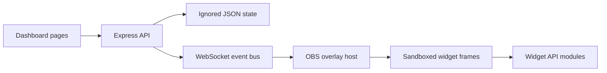

# StreamForge

StreamForge is a local dashboard and OBS browser overlay for community-built stream widgets. This repository is being built in ordered phases; the current baseline provides the dashboard shell, mock event path, starter widgets and an isolated overlay preview.

## Run locally

1. Install Node.js 20 or newer.
2. Copy `.env.example` to `.env` and set only the credentials you intend to use. Keep `.env` private.
3. Run `npm install` and `npm start`.
4. Open `http://localhost:3000/dashboard/`. Set `OPEN_BROWSER=false` to suppress auto-open. Set `PORT` to use a different port.

The initial default is mock mode. The dashboard's Simulate buttons generate local events; they do not contact Twitch. The OBS browser source URL is `http://localhost:3000/overlay/` (the transparent canvas is intended for OBS).

## Twitch callback

Register `http://localhost:3000/auth/twitch/callback` as the OAuth redirect URL in the Twitch Developer Console. If you change `PORT`, use `http://localhost:<PORT>/auth/twitch/callback` instead. Live Twitch behavior is gated by `TWITCH_LIVE_ENABLED=true`.

## Project structure

## Widget API and security

Widget modules export `default { meta, mount(api) }`; the current contract is documented in [docs/WIDGET_API.md](docs/WIDGET_API.md). The overlay uses `sandbox="allow-scripts"` without `allow-same-origin`, and widget static files receive a CSP with `connect-src 'none'`. Widget code must treat event fields as untrusted text. Tokens are never returned by the health or state endpoints.

## Current verification and limits

`npx tsc --noEmit` passed. Mock server checks covered queue behavior and restart persistence; Chrome screenshots confirmed the Overview and widget frames render. The Codex SDK gate was passed by the user. OAuth token exchange, IRC/EventSub connections, the real Codex build pipeline and remaining phase features are still being implemented and must not be considered ready yet.

The Phase 2A mock queue now stores requests, history, votes and widget metadata in ignored JSON state. Approving a request runs a fixed mock fixture through syntax, static safety and mock-mount checks; it does not invoke Codex or convert the request into custom code. The overlay layout engine packs declared widget sizes into the 1920 × 1080 canvas and supports saved manual coordinates.
