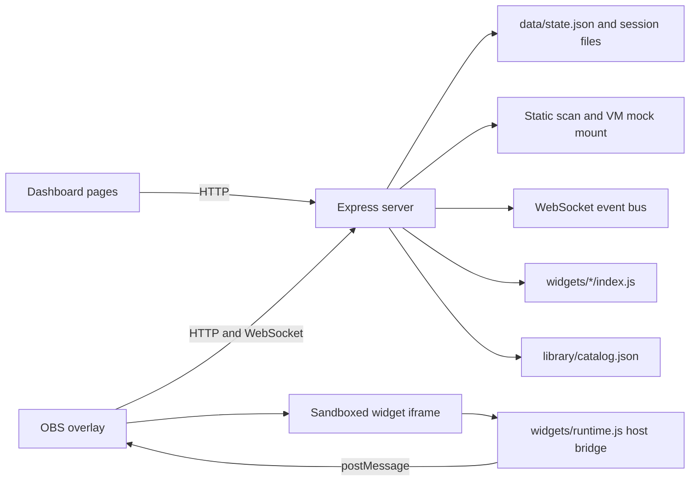

# StreamForge project map

## Architecture

StreamForge is a local Node/TypeScript Express application. `src/server.ts` owns configuration loading, in-memory application state backed by atomic JSON persistence, HTTP APIs, the WebSocket event bus, and the mock build/import/rollback flows. `src/security/` contains request normalization, source scanning, Widget Passport heuristics, and color contrast helpers. `src/hype/engine.ts` computes aggregate activity and `src/sessions/manager.ts` stores session aggregates. The dashboard and overlay are dependency-free HTML, CSS, and JavaScript. Each widget runs in its own `sandbox="allow-scripts"` iframe; the host bridge in `widgets/runtime.js` limits communication to validated events, theme/motion updates, and host-mediated storage. The frame CSP blocks network connections.

## File purposes

| Path | Purpose |
| --- | --- |
| `src/server.ts` | Main process: env parsing, state types/defaults, atomic persistence, HTTP routes, mock request runner, Git rollback, session/hype integration, WebSocket publishing, startup/browser launch. This is currently a large, densely formatted module. |
| `src/security/request-checks.ts` | Unicode normalization, length and blocklist checks, language/script heuristic. |
| `src/security/widget-checks.ts` | Static forbidden-API scan and isolated VM mock mount. |
| `src/security/passport.ts` | Server-generated widget capability and heuristic motion-risk summary. |
| `src/security/contrast.ts` | WCAG color contrast and accessible text-color selection. |
| `src/config/env.ts` | Quoted dotenv parsing and the single live Twitch switch. |
| `src/twitch/oauth.ts` | CSRF-protected authorization code exchange, token validation, scope checks and identity lookup. |
| `src/twitch/token-store.ts` | Atomic mode-0600 token persistence, refresh, status and disconnect. |
| `src/twitch/irc-client.ts` | Twitch IRC WebSocket handshake, parsing and quiet reconnect. |
| `src/twitch/eventsub-client.ts` | EventSub WebSocket session, verified subscriptions, normalization and reconnect. |
| `src/twitch/clips.ts` | Opt-in stream status and clip creation, with scope/live/cooldown/session-cap gates. |
| `src/codex/runner.ts` | SDK-injected real build runner, workspace constraints, stream redaction, output checks and error codes. |
| `src/codex/replay.ts` | Atomic build recording storage and latest successful recording selection. |
| `src/hype/engine.ts` | Bounded activity windows, baseline, smoothing, level and trend calculation. |
| `src/sessions/manager.ts` | Persisted session lifecycle, aggregates, activity and recap data. |
| `public/dashboard/index.html`, `app.css`, `app.js` | Dashboard shell, layout/styles, navigation, state refresh, health strip, and live WebSocket updates. |
| `public/dashboard/pages/*.js` | Separate page renderers for Overview, queue/Build Studio, Widgets, Library, Settings, Sessions, Scenes, and Demo Director. |
| `public/dashboard/preview-backgrounds.js` | Shared exact-color preview backgrounds and per-surface preference helpers. |
| `public/dashboard/recap.js` | Dependency-free recap canvas rendering and image actions. |
| `public/dashboard/demo-sequence.json` | Scripted simulated Demo Director sequence. |
| `public/overlay/index.html`, `overlay.css`, `overlay.js`, `layout.js` | Transparent OBS canvas, widget frame creation/placement, previews, events, theme/motion, feed and replay display. |
| `widgets/frame.html`, `runtime.js` | Sandboxed iframe document and API bridge; imports a widget module after validating host messages. |
| `docs/PREVIEW_BACKGROUNDS.md` | Exact preview colors, persistence scopes and transparent OBS default. |
| `widgets/widget.css` | Shared CSS tokens and base widget styles. |
| `widgets/*/index.js` | Nine built-in widget modules: dice roller, prediction scoreboard, boss bar, goal bar, poll, countdown, screen effects, welcome banner, and Chat Runner. |
| `library/catalog.json` | Curated Library records, prompts and creator metadata. |
| `templates.json` | Build prompt template catalog. |
| `docs/WIDGET_API.md` | Public widget contract, security constraints, optional APIs and heuristics. |
| `docs/AUTO_CLIPS.md` | Verified Twitch API references, opt-in behavior and limits. |
| `docs/HOW_WE_USED_CODEX.md` | Commit-history-based development and safety-model record. |
| `docs/QA_REPORT.md` | Phase 4B QA harness baseline, checks and known limits. |
| `scripts/qa-ui.mjs` | Mock server + installed Chrome/CDP dashboard and overlay visual QA. |
| `scripts/qa-phase3.mjs` | Phase 3 isolated browser/API smoke across pages and widgets. |
| `scripts/check-*.mjs` | Focused widget, template, Passport, Hype, sessions, scenes, clips, multilingual, Demo Director, dotenv, OAuth, token store, IRC, EventSub, fake Twitch clips API, sandboxed theme pixel/token proof, fake Codex runner, verification, replay and startup checks; `*-api` scripts start local mock servers. |
| `scripts/diagnose-phase4b.mjs` | Phase 4B UI/preview diagnostic probe. |
| `scripts/check-theme-frames.mjs` | Phase 4B sandbox frame theme-token diagnostic/check. |
| `scripts/restart.mjs` | Stops the current local process on the configured port and restarts the app. |
| `scripts/codex-check.mjs` | One-time SDK gate. Do not run it. |

## HTTP routes

Static routes: `/` redirects to `/dashboard/`; `/dashboard`, `/overlay`, and `/widgets` serve local assets. The implemented API groups in `src/server.ts` are:

- Health/state: `GET /api/health`, `GET /api/state`.
- Queue/build: `POST /api/requests`, `POST /api/requests/:id/:action`, `GET /api/requests/:id/preview`, `POST /api/chat`, `PATCH /api/settings`, `POST /api/codex/verify`.
- Widgets/Library: `GET /api/library`, `GET /api/templates`, `GET|PATCH /api/widgets/:id/storage`, `GET /api/widgets/:id/export`, `POST /api/library/import`, `POST /api/library/:id/add`, `PATCH|DELETE /api/widgets/:id`, `POST /api/widgets/:id/undo`, `POST /api/widgets/:id/remix`, `POST /api/widgets/:id/runtime-error`, `POST /api/widgets/:id/moment`.
- Events and operations: `POST /api/simulate/:event`, `GET /api/hype`, `POST /api/hype/simulate`, `PATCH /api/hype/settings`, `GET /api/clips`, `PATCH /api/clips/settings`, `POST /api/clips/manual`.
- Sessions: `GET /api/sessions`, `POST /api/sessions/start`, `POST /api/sessions/end`, `PATCH /api/sessions/settings`, `GET /api/sessions/:id`, `GET /api/sessions/:id/recap.json`, `GET /api/sessions/:id/export.json`, `DELETE /api/sessions/:id`.
- Presentation: `GET /api/scenes`, `POST /api/scenes/:id/apply`, `POST /api/scenes/undo`, `POST /api/scenes/duplicate`, `PATCH|DELETE /api/scenes/:id`, `GET /api/demo/status`, `POST /api/demo/start|stop|natural20|replayed-build`, `PATCH /api/theme`, `POST /api/theme/contrast-fix`, `PATCH /api/safe-mode`, `POST /api/theme/generate`, `POST /api/kits/:id`.
- Twitch authorization has `GET /auth/twitch`, `GET /auth/twitch/callback`, and `POST /api/twitch/disconnect`. OAuth and local client implementations exist; live connections remain unverified manually.

## WebSocket messages

Server-to-client message types include `hello`, `event`, `request`, `queue`, `buildFeed`, `draftPreview`, `code`, `chat`, `widgets`, `theme`, `safeMode`, `hype`, `hypeSettings`, `session`, `scene`, `demoStatus`, `moderation`, and `runtimeError`. Browser clients use `/ws`. Overlay-to-frame `postMessage` kinds are `streamforge:event`, `streamforge:theme`, `streamforge:safe-mode`, `streamforge:hype`, and `streamforge:storage:init`; frame-to-host messages cover storage get/set, error reporting and validated moments.

## State and settings

The main `Store` shape is `requests`, `requestHistory`, `widgets`, `library`, `settings`, optional `widgetStorage`, and optional `codexVerification`. It is saved atomically to `data/state.json` (or `STREAMFORGE_DATA_DIR`). Settings cover approval mode and thresholds, build mode/timeout/retry preference, theme preset/tokens, Safe Mode, Hype sensitivity/boost/mute/reactivity/overlay meter, session idle/name preferences, Auto-Clips opt-in/triggers/cooldown/cap, and active scene/undo snapshot. Twitch tokens live in ignored `data/twitch-token.json`; sessions live below `data/sessions`; user scene presets live in `data/scenes.json`; successful or failed Codex build event records live in ignored `replay/*.json`. Development verification uses mocks/fakes; live SDK/Twitch behavior remains unverified.

## Widget runtime and security

Widget metadata declares title, description, dimensions, initial coordinates and anchor. The overlay auto-layout helper packs enabled widgets; each iframe has `sandbox="allow-scripts"` without `allow-same-origin`. `widgets/frame.html` carries a restrictive CSP including `connect-src 'none'`. `src/security/widget-checks.ts` performs source scanning and VM mock mounting before imports or mock builds are promoted. The host bridge exposes only documented API methods and mediates persisted storage. Git-backed widget history supports a checked rollback. Request/chat text is normalized and displayed as text; activity has path and username redaction. Do not weaken these controls.

## npm scripts and what they prove

| Script | Evidence |
| --- | --- |
| `npm run build` | Compiles TypeScript to `dist/`. |
| `npm start` | Builds, starts the local server and opens the dashboard unless `OPEN_BROWSER=false`. |
| `npm run restart` | Restarts the local server on its configured port. |
| `npm run test:widgets` | Static scans/mock mounts the widget set, checks dice natural-20 fireworks and simulated starter-pack interactions. |
| `npm run test:templates` | Validates each template prompt and its referenced Library widget. |
| `npm run test:passport` | Exercises Passport output, heuristic risk summary, scan summary and contrast repair. |
| `npm run test:hype` | Tests synthetic engine traffic and isolated HTTP/WebSocket behavior/privacy. |
| `npm run test:sessions` | Tests session aggregates/lifecycle and isolated API persistence/export/delete. |
| `npm run test:scenes` | Tests saved scene behavior, application, widget retention and Undo through mock HTTP. |
| `npm run test:clips` | Tests default-off state, settings validation, disabled clip response, moment allow-list and rate limit. |
| `npm run test:multilingual` | Tests normalization, length, script/confusable heuristics and API manual-review gating. |
| `npm run test:demo` | Tests the simulated sequence, APIs, restore behavior and recap marker. |
| `npm run qa:phase3` | Isolated Phase 3 mock API/browser regression smoke. |
| `npm run qa:ui` | Dashboard viewport and overlay browser diagnostics/screenshots; does not yet audit Library widgets individually. |
| `npm run codex:check` | SDK login/build gate only; prohibited to run during this continuation. |

## Current baseline and known gaps

On 2026-10-31, `npx tsc --noEmit` and all nine `npm test:*` scripts passed in an isolated/mock context. The server API scripts required an approved unsandboxed localhost bind; no real Twitch traffic or SDK build was used. Phase 4B Stage 1 `qa:ui` exists. The continuation's next work is real integrations implemented in new modules and tested only with fake SDK/server fixtures, then Phase 4B recovery and stages 2–6. At this map's creation, `src/twitch/` and `src/codex/` do not exist; OAuth exchange, token storage/refresh, IRC, EventSub, real Codex builds, real replay recording, stream status and clip creation are missing. Stage 4B still needs overview recovery, theme proof/fixes, shared preview backgrounds, Library reliability audit, and final regression close.
